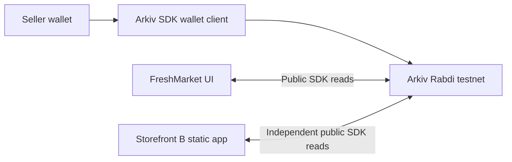

# Why FreshMarket uses Arkiv

FreshMarket's core promise is a seller-owned listing that can be read by more than one marketplace. Arkiv provides public, schema-tagged queryable entities, wallet-controlled mutations, and protocol-enforced expiration. The seller publishes once and readers discover that same entity key without requesting access to FreshMarket's private database.

PostgreSQL or Firebase would be reasonable choices for a centrally operated marketplace: they offer familiar tooling, private access control and low-latency writes without a wallet transaction. Public feeds and APIs could also provide portability, but would depend on the operator continuing to expose them. Arkiv makes the shared source and authorization independent of the FreshMarket application server. It is chosen for that ownership and interoperability model, not because databases cannot support search or expiry.

## Two clients, one public contract

FreshMarket's repository and Storefront B's `storefront/src/reader.ts` independently query the public `freshmarket.listings.v2` schema. Storefront B has its own schema declaration, public client, transport, rendering and refresh loop. It imports no FreshMarket repository, hooks, provider or API. It has no wallet and requires no local storage. Its generated HTML/CSS/JS can be hosted on another static host without Next.js.

Matching schema tags alone do not prove trustworthy provenance: anyone can use the same tag. Both readers require the indexed seller to match Arkiv's actual entity owner. Entity keys and seller addresses stay visible so the demo can establish that both interfaces read the same record. This proves portable data; it does not prove marketplace moderation or item authenticity.

FreshMarket's buyer catalogue shows available listings. Storefront B defaults to all live statuses, so a reserved/sold status remains inspectable there until expiration. Marking sold is not expiry, deletion or payment settlement. Those are separate operations.

## Honest trade-offs

- Writes and lifetime extensions require gas/storage fees, a funded wallet, and user approval. Rabdi uses test tokens; this is a testnet demonstration.
- Public indexing may lag a confirmed write. The app retries reads with bounded backoff and preserves confirmed transaction references. Storefront B polls every 15 seconds while visible and can be refreshed manually. Updates are eventually visible, not guaranteed immediate.
- Public RPC requests are rate limited. Separate origin-restricted access keys are recommended for FreshMarket and the independent storefront.
- Public records are public. Do not publish personal addresses, secrets or private buyer communications in listing metadata.
- Expiration is a block height. The countdown uses Rabdi's two-second target and is an estimate; queries and confirmed blocks determine absence. No FreshMarket cron deletes expired listings.
- Deleted/expired records are absent from live queries. Neither storefront is an archival service. Pagination can shift during concurrent writes/expiry, and the current catalogue readers load all pages, which increases RPC cost as the catalogue grows.

## Evidence and limits

Automated tests rehearse matching entity keys, changed prices, reserved/sold states and expiration through two separately instantiated real SDK clients with fixture RPC responses. Optional live checks read both real public clients. Neither test fabricates a transaction or proves that a seller has performed a live write. See [the demo walkthrough](portability-demo.md) for the evidence required before recording the live submission.
