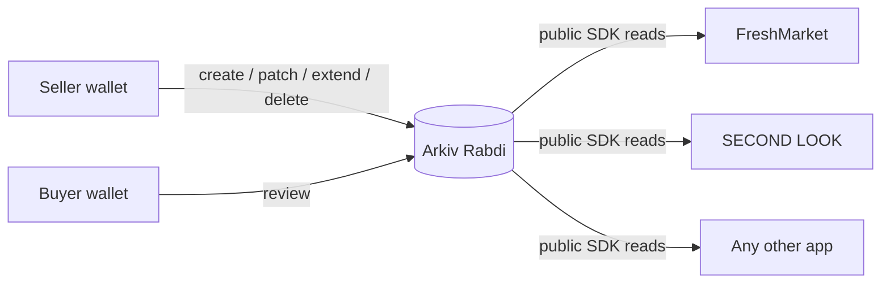

# Why Arkiv

FreshMarket's promise is **publish once, sell anywhere, and let stale listings disappear on their own.** Arkiv gives us all three in the data layer itself. In a Postgres version, each would depend on us running a server and behaving well.

## What users would lose with Postgres

| With Arkiv | With Postgres (or Firebase, Supabase…) | Who loses |
| --- | --- | --- |
| **The seller's wallet owns the listing.** Only that wallet can patch, extend or delete it. Checked live: another wallet's patch and delete of our real listing fail with `NotOwner` ([TEST_REPORT.md](../TEST_REPORT.md)) | Our server decides who can edit. An admin, a bug or a breach can change any listing | Sellers |
| **Any app can read the same listings.** SECOND LOOK is a separate static app with its own SDK client and no FreshMarket code, and it shows the same entity key | Other storefronts need our API, our key and our permission. If we shut down, the listings go with us | Sellers, other storefronts |
| **Listings expire by protocol.** Each one has `$expiresAt`. When it passes, the listing is gone from every query in every app, with no cron job | A cleanup job we have to run. If it fails, buyers see stale listings, which is the problem we set out to fix | Buyers |
| **Search is a public, indexed contract.** Category, brand, city, price and condition are indexed attributes anyone can filter on (`npm run query:listings`) | Search exists only inside our backend | Other storefronts |
| **Reviews belong to the buyer** who wrote them, tied to a FreshPay order ID, and readable by any storefront | Reviews live in our table, and we could delete or edit them | Buyers, sellers |

Postgres would be faster and wouldn't need wallet signatures. For a single marketplace it's the better tool. FreshMarket isn't meant to be a single marketplace: the listing should outlive the app that created it.

## What we kept off Arkiv, and why

| Data | Where it lives | Why not Arkiv |
| --- | --- | --- |
| Seller name, avatar, bio, verified badge | ENS on Sepolia (`alice.freshmarket.eth`) | Names are an existing standard every wallet already resolves. Storing a copy on Arkiv would let the two drift apart. We show a name only if it resolves to the listing's seller |
| Payment, escrow, "one sale per listing", refunds | FreshPay contract on Whitechain Sepolia | Money needs atomic rules ("only one buyer can pay for this listing") that a database entity can't enforce. FreshPay reads the price from Arkiv but never writes to it |
| Photos | Swarm or HTTPS, with only the reference stored on Arkiv | Image bytes are too big for entity attributes. The `media` attribute holds `bzz://` or `https://` references |
| Shipping address, phone, dispute evidence | Not stored on-chain (private, off-chain) | Everything on Arkiv is public, including unindexed fields. We tell sellers not to put contact details in listings |
| Pending-transaction state | Browser memory | It's temporary UI state, not shared data |

## Trade-offs we accept

- Every write needs a wallet signature and testnet gas.
- Public reads can trail a confirmed write by a few seconds. The app keeps the transaction hash and retries the read.
- Expiry is a block height. Countdowns are estimates from Rabdi's 2-second block target.
- Anyone can write rows with our schema tag, so every reader checks `seller == $owner` ([schema.md](schema.md#reader-rules)).
- The Rabdi public RPC is rate limited. Each app uses its own origin-restricted access key.
